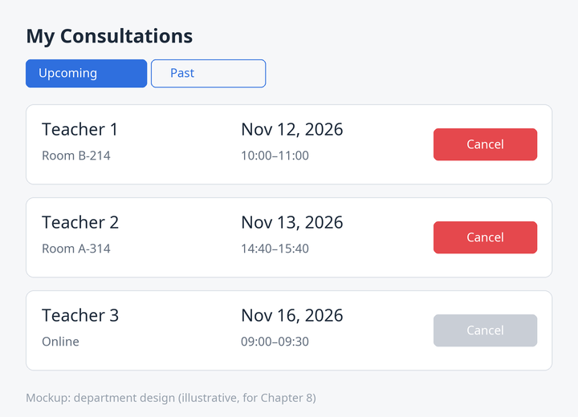

# RoomBook

[Українською](README.md) · **English**

RoomBook is a service for booking classrooms and consultations at a university
department: students and teachers book rooms for class periods, teachers open
consultation slots (office hours) and weekly series, and students sign up for
consultations and join a waitlist. It is a teaching project: the running
example of the textbook *Developing with Codex: Agentic Software Development*
by Ya. Yu. Dorohyi. Every chapter of the book changes the code, and the state at
the end of each chapter is recorded with an annotated tag.

The book has two editions that use this repository:

| Edition | Title | Language of the repository it describes |
|---|---|---|
| Ukrainian (original) | *Developing with Codex: агентна розробка програмного забезпечення* | Ukrainian (this repository as is) |
| English (translation) | *Developing with Codex: Agentic Software Development* | the same Ukrainian repository; listings in the book are translated, see [Using the repo with the English edition](#using-the-repo-with-the-english-edition) |

The narrative of the book (people, issues, PRs, incidents, dates) is fictional;
issue and PR numbers belong to the story and are not reproduced in the
repository. All runs, durations, budgets, metrics and counters of RoomBook in
the book are illustrative data of the teaching example. The golden files of the
weekly report (`apps/api/test/golden/room-week/`) are synthetic.

## Layout

| Directory | What it is |
|---|---|
| `apps/api` | `@roombook/api` – Node 22, TypeScript, Fastify 5, Prisma 6, PostgreSQL 16, zod |
| `apps/web` | `@roombook/web` – React 19 + Vite 7, Vitest + Testing Library, Playwright |
| `packages/shared` | `@roombook/shared` – zod schemas, domain errors, `percentOf`, waitlist contract |
| `packages/mcp-db` | `@roombook/mcp-db` – read-only MCP server `roombook_db` (Chapter 8) |
| `legacy-php/` | old room occupancy reports (PHP 5 style, mysqli, cp1251, no tests) |
| `tools/` | Codex profiles and rules, CI scripts, cloud environment, agent worktrees, metrics; `tools/en/` – files for the English edition |
| `docs/` | specs, plans, backlog, debugging logs, review policy, threat model (in Ukrainian); `docs/en/` – English reference tables |

## Cloning and tags

```bash
git clone https://github.com/argusyk/roombook.git ~/src/roombook
cd ~/src/roombook
git tag -l 'ch*'                                   # list of chapter tags
git switch -c ch02-first-session ch02-start        # a branch for the Chapter 2 exercises
```

Each annotated tag records the state of the code at the end of a chapter. The
starting tag for the exercises of Chapter N is the end tag of the nearest
preceding chapter that changed the code. Chapters 1 and 2 do not change the
code. The tag `ch18-end` is the final state of the book; `main` is `ch18-end`
plus the English-edition files listed below (they change no code).

| Tag | State of the code | Starting tag for the exercises of Ch. |
|---|---|---|
| `ch02-start` | the state described in Chapter 1: the `winter schedule` test is red, no AGENTS.md or profiles | 2, 3 |
| `ch03-end` | time zone fixed in `slots.ts`, three tests for the DST switch | 4 |
| `ch04-end` | booking series (`BookingSeries`, `POST /booking-series`), `docs/plans`, `docs/backlog.md` | 5 |
| `ch05-end` | three AGENTS.md files, `AGENTS.override.md` in `.gitignore` | 6 |
| `ch06-end` | `tools/codex/profiles/{safe,work,ci}.config.toml`, `install-profiles.sh`, `.codex/config.toml` | 7 |
| `ch07-end` | `tools/codex/rules/roombook.rules`, `checkpoint.sh`, `deps` profile, `tools/dev/test-int.sh` | 8 |
| `ch08-end` | `packages/mcp-db`, MCP in `.codex/config.toml`, `db-report` skill, `MyConsultations.tsx`, `GET /me/bookings` | 9 |
| `ch09-end` | `SlotForm.tsx`, `lib/forms/fieldErrors.ts`, `apps/web/AGENTS.md` | 10 |
| `ch10-end` | properties P1 and P2 (fast-check), `lt/gt` fix, e2e `booking-flow.spec.ts`, Stryker, `test-guard.sh` | 11 |
| `legacy-room-week-final` | story tag of Chapter 11: last version of `room_week.php` before it was switched off | – |
| `ch11-end` | weekly report in `apps/api`, `percentOf()`, golden files, codemod | 12 |
| `ch12-end` | `booking_no_overlap` constraint, 23P01 → 409, atomic series, no N+1, `docs/debugging/` | 13 |
| `ch13-end` | `tools/cloud/*`, iCal export, reminders, room statistics | 14 |
| `ch14-end` | waitlist (`WaitlistEntry`, three routes), `wt-new.sh`, `wt-rm.sh` | 15 |
| `ch15-end` | promotion notification and sign-up closing 2 h before the start, `docs/review-policy.md`, CODEOWNERS | 16 |
| `ch16-end` | `ci.yml` (jobs `lint`, `test`, `e2e`), `codex-autofix.yml`, `codex-review.yml`, `codex-nightly.yml`, `fix-loop.sh`, `summarize-run.sh`, `nightly-triage.mts` | 17 |
| `ch17-end` | `docs/security/threat-model.md`, `report` profile, canary (user 9001 in the seed), secret scanning in CI, explicit `permissions` | 18 |
| `ch18-end` | `tools/metrics/*` – metrics scripts and the CSV schema | – |

`docker-compose.yml` and `pnpm db:up` exist from `ch02-start`. The branches
mentioned in the story (`ch05-agents-md`, `ch10-tdd`,
`feature/recurring-bookings`, `agent/<role>/<issue>`) are the reader's local
branches. The repository has only `main` and the tags. Tags are never moved.

## Setup

You need Node 22, pnpm (through corepack) and Docker for PostgreSQL 16.

```bash
corepack enable
pnpm install --frozen-lockfile
pnpm db:up                                   # docker compose up -d db: databases roombook and roombook_test
cp apps/api/.env.example apps/api/.env       # DATABASE_URL of the local database
pnpm --filter @roombook/api exec prisma migrate deploy
pnpm --filter @roombook/api exec prisma db seed
pnpm --filter @roombook/api dev              # API on :3000
pnpm --filter @roombook/web dev              # web on :5173 (proxy /api → :3000)
```

Login in development is `POST /auth/dev-login` with an email from the seed
(`teacher1@roombook.test`, `student01@roombook.test`, …); there are no
passwords, and dev login is disabled in production.

## Scripts and tests

Root scripts (`package.json`): `pnpm typecheck`, `pnpm lint`, `pnpm test`
(all packages; large output), `pnpm test:e2e`, `pnpm db:up`.

| What | Command | Database |
|---|---|---|
| type check, linter | `pnpm -r typecheck`, `pnpm -r lint` | no |
| unit tests | `pnpm --filter @roombook/api test:unit`, `pnpm --filter @roombook/web test`, `pnpm --filter @roombook/shared test` | no |
| API integration tests | `pnpm --filter @roombook/api test:int` or `tools/dev/test-int.sh` | yes |
| all API tests | `pnpm --filter @roombook/api test` | yes |
| e2e (Playwright) | `pnpm --filter @roombook/web test:e2e` (API and web running) | yes |

Integration tests use a separate database `<database from DATABASE_URL>_test`
(by default `roombook_test`, created by `pnpm db:up`) and apply the migrations
to it themselves (globalSetup runs `prisma migrate deploy`), so after
`pnpm db:up` it is enough to run `pnpm --filter @roombook/api test`.

### Tests and the agent sandbox

In `workspace-write` mode with the network disabled, the agent's commands can
connect neither to PostgreSQL on `localhost` nor to the dev server. Therefore:

| What | Who and where |
|---|---|
| typecheck, lint, unit tests | the agent in the sandbox (profiles `work`, `ci`) |
| integration tests with PostgreSQL | a human in a separate terminal; the agent only after approval of the exact command outside the sandbox; in CI a separate step/job |
| e2e, dev server | a human starts the API and web outside the agent; e2e is run by a human or by CI (job `e2e`) |
| installing dependencies | a human before the session, or a short session with the `deps` profile |
| Codex Cloud | the environment container; PostgreSQL is started by `tools/cloud/install.sh` and `tools/cloud/start.sh` |

Codex profiles and rules are installed by `tools/codex/install-profiles.sh`
(into `~/.codex/`): `codex -p safe`, `codex -p work`, `codex -p deps`,
`codex exec -p ci …`, `codex exec -p report …`.

## CI and Codex automation

`.github/workflows/ci.yml` – job `lint` (lint, typecheck, secret scanning),
`test` (unit + integration with `postgres:16`), `e2e` (Playwright against the
API and web).

The Codex workflows (`codex-autofix.yml`, `codex-review.yml`,
`codex-nightly.yml`) are safe by default in a public repository: without the
`CODEX_API_KEY` secret all their jobs are skipped, permissions are minimal
(`permissions: {}` at the workflow level), `pull_request_target` is not used,
and the nightly triage runs only manually (`workflow_dispatch`). To enable them
in your own fork, add the `CODEX_API_KEY` secret, the labels (`codex-autofix`,
`codex-draft`, `agent-ready`, `agent-running`, `agent-pr-open`,
`agent-needs-info`) and branch protection for `main`.

## Using the repo with the English edition

The repository is in Ukrainian: README.md, the AGENTS.md files, documentation in
`docs/`, code comments, UI labels, error messages, seed data, test names,
commit messages and tag annotations. Identifiers, file names, commands and
configuration keys are in English. The code listings in the English book are
translated. This does not matter for reading, but it does matter in three
places, and the repository has an English aid for each of them:

| Problem | Aid on `main` |
|---|---|
| Codex reads the Ukrainian AGENTS.md files and may reply in Ukrainian | English overrides in `tools/en/agents/` and the scripts `tools/en/use-english-agents.sh` / `.ps1` |
| A listing in the book uses an English label (`getByLabel("Start")`), but the UI has `Початок` | [`docs/en/ui-strings.md`](docs/en/ui-strings.md) – Ukrainian → English table of UI strings, API messages, seed data and test names |
| Commit messages and tag annotations are Ukrainian (exercise 10.7 and others) | [`docs/en/commit-history.md`](docs/en/commit-history.md) – English translation of every commit `ch02-start` … `ch18-end` and every tag annotation |
| The Chapter 8 mockup is in Ukrainian | [`docs/mockups/my-consultations.en.png`](docs/mockups/my-consultations.en.png) |

**Do not translate the UI strings in the code.** The e2e tests look for
elements by their Ukrainian accessible names, and the agent's instructions
forbid changing button texts. When you type a listing from the book, take the
functional strings (labels, button names, expected messages) from
`docs/en/ui-strings.md`, for example:

```ts
await page.getByLabel("Початок").fill(`2027-03-16T${from}`);       // book: "Start"
await page.getByRole("button", { name: "Забронювати" }).click();    // book: "Book"
await expect(page.getByRole("status")).toHaveText(/Бронювання підтверджено/); // book: /Booking confirmed/
```

### English agent instructions (AGENTS.override.md)

How Codex picks the instruction files ([Codex docs: AGENTS.md](https://learn.chatgpt.com/docs/agent-configuration/agents-md)):

- **Global scope:** in `CODEX_HOME` (default `~/.codex`) Codex reads
  `AGENTS.override.md` if it exists, otherwise `AGENTS.md`; only the first
  non-empty file is used.
- **Project scope:** from the project root (usually the Git root) down to the
  current working directory, Codex checks each directory for
  `AGENTS.override.md`, then `AGENTS.md`, then the names in
  `project_doc_fallback_filenames`, and takes **at most one file per
  directory**. So an `AGENTS.override.md` replaces the `AGENTS.md` in the same
  directory; it does not add to it.
- The files are concatenated from the root down; files closer to the working
  directory come later and therefore take precedence. The combined size is
  limited by `project_doc_max_bytes` (32 KiB by default).
- The chain is rebuilt on every run and at the start of every TUI session;
  restart Codex after changing the files.

RoomBook adds `AGENTS.override.md` to `.gitignore` in Chapter 5, so an override
is a local, uncommitted file. `tools/en/agents/` holds English translations of
all four instruction files, with one extra section: reply in English, keep the
repository's Ukrainian strings unchanged, and write new UI texts in Ukrainian
(the RoomBook UI language).

| English file in `tools/en/agents/` | Installed as | Replaces |
|---|---|---|
| `root.AGENTS.override.md` | `AGENTS.override.md` | `AGENTS.md` |
| `apps-api.AGENTS.override.md` | `apps/api/AGENTS.override.md` | `apps/api/AGENTS.md` |
| `apps-web.AGENTS.override.md` | `apps/web/AGENTS.override.md` | `apps/web/AGENTS.md` (from `ch09-end`) |
| `legacy-php.AGENTS.override.md` | `legacy-php/AGENTS.override.md` | `legacy-php/AGENTS.md` |
| `by-tag/*.AGENTS.override.md` | (same targets) | earlier versions of the same files, see below |

Install them with the script. It writes an override only next to an existing
AGENTS.md and picks the translation that matches the AGENTS.md of the
checked-out commit (the Ukrainian files grow between Chapters 5 and 15: the
Tests section in Ch. 10, migration rules in Ch. 11, `booking_no_overlap` in
Ch. 12, database tests in Ch. 13, review rules in Ch. 15). Before `ch05-end`
there is no AGENTS.md, so nothing is installed.

```bash
# on main
bash tools/en/use-english-agents.sh
# on a chapter branch made from a tag (tools/en/ does not exist there)
git show main:tools/en/use-english-agents.sh | bash
# check what the agent sees
codex --ask-for-approval never "Summarize the current instructions."
# remove the overrides
git show main:tools/en/use-english-agents.sh | bash -s -- --remove
```

Windows PowerShell:

```powershell
git show main:tools/en/use-english-agents.ps1 > $env:TEMP\use-english-agents.ps1
powershell -ExecutionPolicy Bypass -File $env:TEMP\use-english-agents.ps1          # install
powershell -ExecutionPolicy Bypass -File $env:TEMP\use-english-agents.ps1 -Remove  # remove
```

Run the script again after switching to another tag. It never overwrites or
deletes an `AGENTS.override.md` that it did not create (for example, one you
wrote in a Chapter 5 exercise). Remember the warning from Chapter 5: a forgotten override silently
replaces the team file, and the file sizes quoted in Chapter 5 refer to the
Ukrainian originals. A single file by hand works too:
`git show main:tools/en/agents/root.AGENTS.override.md > AGENTS.override.md`
(main version; in PowerShell 5.1 use the script, because `>` writes UTF-16).

A lighter alternative is one line in your personal `~/.codex/AGENTS.md`, for
example "Reply in English; the repository texts may be in Ukrainian". The agent
then still reads the Ukrainian project rules but answers in English.

### Chapter 8 mockup



`docs/mockups/my-consultations.en.png` is the same mockup as
`docs/mockups/my-consultations.png` with English labels (My Consultations,
Upcoming / Past, Cancel, Teacher 1, Room B-214). The page the agent builds
should still use the Ukrainian labels of the repository (Мої консультації,
Майбутні / Минулі, Скасувати), as the original component does. The mockups are
added in Chapter 8, so on a branch made from `ch07-end` fetch the file first:

```bash
git restore --source=main -- docs/mockups/my-consultations.en.png
codex -i docs/mockups/my-consultations.en.png "Implement the \"My Consultations\" page ..."
```

### English files on an older tag

The English files exist only on `main` (tags are never moved). To get them
into the working tree of a chapter branch without staging them:

```bash
git restore --source=main -- README.en.md tools/en docs/en docs/mockups/my-consultations.en.png
```

They appear as untracked files; do not commit them to your exercise branch, and
remove them with `git clean -n` (dry run) and then `git clean -f -- <paths>` when
you no longer need them. To just read them, use GitHub or `git show main:<path>`.

## License

MIT, see `LICENSE`.
